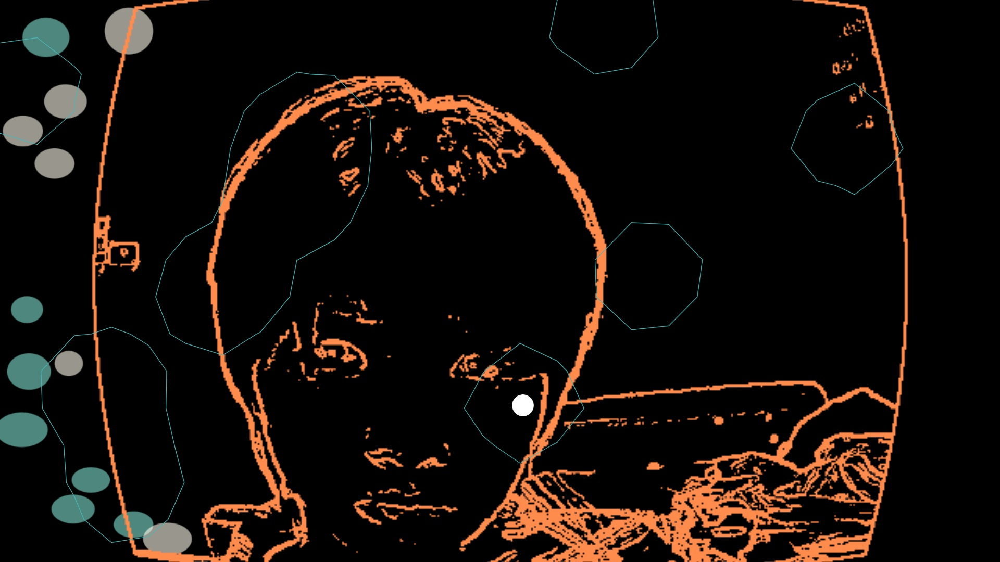

# ChucK Music Game

## 線上互動

[進入網站互動](https://19359cyh.github.io/ChucK_Music_Game/)

由滑鼠位置控制聲光變化：

- 垂直位置控制音高。
- 水平位置改變濾波器頻率。
- 滑鼠需在畫面上移動，才能即時控制聲音。

## 預覽

## 錯誤排除

1. 請允許使用前置鏡頭畫面。
2. 初次進入網站時，網站會載入所需資料，請等待約 10 秒，畫面便會正常呈現。
3. 若 metaball 效果未能正常顯示，請重新整理頁面。